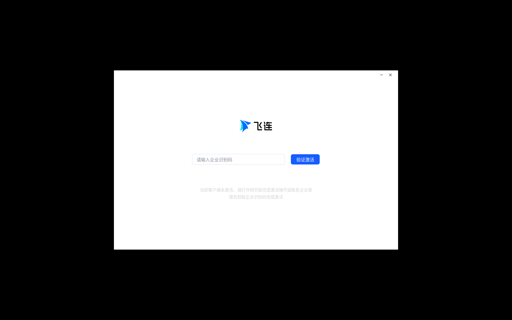

# 飞连 (FeiLian) Linux 客户端 · Docker 化运行环境

把火山引擎 **飞连 Linux 客户端** 关进一个容器里跑，窗口映射回宿主机，网络走宿主机现有链路，
容器内看不到宿主机任何文件内容。

- 官方安装包：`com.volcengine.feilian` **3.2.16**（Electron 22.3.27），来自
  [飞连官方下载页](https://www.volcengine.com/product/feilian/download) 的 CDN 直链
- 基础镜像：`debian:trixie-slim`（与宿主机 Debian 13 对齐）
- 窗口：容器内 `Xvfb → x11vnc → noVNC`，宿主机浏览器打开 `http://127.0.0.1:6080/`
  （也支持 `GUI_MODE=x11`，只挂一个 X socket 直接画到宿主机桌面）
- 隔离：**零宿主目录挂载**。只有 3 个 docker 命名卷（home / root / logs），
  没有 `-v /home:/host`、没有 `docker.sock`、没有 `privileged`，只有 `NET_ADMIN` + `NET_RAW`

---

## 目录

```
.
├── Dockerfile                 镜像：Electron 运行库 + Xvfb/x11vnc/noVNC + 飞连
├── compose.yaml               默认：bridge 网络 + NAT
├── compose.host.yaml          host 网络：容器直接用宿主机网络栈（含 WiFi/代理）
├── compose.macvlan.yaml       macvlan：容器以独立 IP 出现在二层网络（有线）
├── build.sh                   构建镜像（--network host 适配本机代理）
├── run.sh                     一键启动，自动选择可用网络模式
├── stop.sh                    停止
├── scripts/
│   ├── fetch-deb.sh           从飞连官网解析 Linux 安装包直链并下载到 dist/
│   ├── entrypoint.sh          容器 PID1：dbus / NetworkManager / 服务 / GUI / VNC
│   ├── feilian-gui.sh         手动前台起 GUI（调试）
│   ├── host-net.sh            宿主机侧网络准备（ufw 转发、无线/代理检测）
│   └── net-macvlan.sh         macvlan 网络创建/删除
├── verify/
│   ├── isolation.sh           证明容器看不到宿主机文件
│   ├── window.sh              抓容器内窗口截图 + X 窗口树
│   └── network.sh             容器网络连通性检查
└── dist/                      官方安装包（git 忽略）
```

## 快速开始

```bash
# 1. 下载官方 Linux 客户端（250MB，解析官网当前版本直链）
bash scripts/fetch-deb.sh

# 2. 构建镜像（首次约 5~10 分钟，取决于 apt 源速度）
./build.sh

# 3. 启动
./run.sh
#    → http://127.0.0.1:6080/vnc.html?autoconnect=1&resize=scale

# 4. 验证
bash verify/window.sh      # 抓图，确认飞连登录窗口渲染
bash verify/isolation.sh   # 确认容器内没有宿主机文件
```

宿主机没有浏览器/桌面时，用 VNC 客户端连 `127.0.0.1:5900`（端口只绑回环，需要 SSH 隧道）：

```bash
ssh -L 6080:127.0.0.1:6080 you@host   # 然后本地浏览器开 http://127.0.0.1:6080/
```


## 本机实测结果（2026-10-29）

环境：Debian 13 / 内核 6.12 / Docker 29.7.2 / 无桌面、**无无线网卡**（只有 `enp1s0`，出口经 mihomo TUN 代理）。

| 项 | 结果 |
|---|---|
| 官方安装包 | `FeiLian_Linux_amd64_v3.2.16_r8362_0d182a.deb`，250,082,966 字节，sha256 `0ecaf5a4…946a9d3` |
| 镜像 | `feilian-gui:3.2.16`，2.29GB（Electron + Xvfb/noVNC + 客户端） |
| 客户端启动 | `corplink-service` 监听 `31055/31056`，Electron GUI 以 `feilian` 用户渲染到 `:99` |
| 窗口 | 正常显示“飞连 / 请输入企业识别码 / 验证激活”，中文字体正常（见下图） |
| 网络 | 容器内 `https://www.baidu.com` `https://www.volcengine.com` 均 200（host 模式） |
| 隔离 | `verify/isolation.sh` PASS：挂载只有 3 个命名卷，无宿主机目录，`/home/glory`、`/var/lib/docker` 均不可见，`/etc/shadow` 与宿主机不同，`Privileged=false`、`CapAdd=[CAP_NET_ADMIN CAP_NET_RAW]` |
| 网络模式 | `auto` 实测：bridge 出网被 mihomo 劫持 → 自动切 `host`（日志会打印原因） |
| 无法验证 | 真实登录/隧道：没有企业识别码和账号；WiFi 关联：本机没有无线硬件 |



> 抓图命令：`bash verify/window.sh`（容器内 `scrot` → 拷回 `artifacts/`）。

### 为让它跑起来，宿主机上动了什么

- `ufw route allow in on <docker网桥> out on <上行口>` 及其反向：只在 bridge 模式需要，
  `scripts/host-net.sh` 幂等添加；不想要就 `sudo ufw status numbered` 找到后 `delete`。
- 没有改 mihomo 配置、没有改 Docker daemon、没有关防火墙。

## 网络：三种模式，按宿主机环境选

| 模式 | 容器看到什么 | 适合 | 代价 |
|---|---|---|---|
| `bridge`（默认） | Docker 网桥 + NAT，出口是宿主机当前链路（笔记本上=WiFi） | 普通 Docker 宿主机 | 无 |
| `host` | 直接用宿主机网络栈 | 宿主机有透明代理/防火墙打断 bridge 时 | 飞连的 tun/路由落在宿主机 netns |
| `macvlan` | 独立 IP 出现在宿主机所在二层 | 有线、且交换机允许额外 MAC | 无线 STA 基本不可用；容器与宿主机不通 |

`run.sh` 会先用镜像跑一次出网探测：`bridge` 通就用 `bridge`，不通自动切 `host` 并说明原因。
本机（Debian 13 + mihomo TUN 透明代理）实测 **bridge 出网被劫持**，所以本机走 `host`；
在普通笔记本/服务器上默认就是 `bridge`。

### 关于“让容器里的飞连连 WiFi”

这里必须说清楚三件事，因为它们决定了能做到什么程度：

1. **飞连不是 WiFi 管理器**。它的 Linux 客户端是企业零信任/VPN 客户端：在现有网络上建
   tun 隧道、跑准入与合规检查。它“连 WiFi”只发生在 **网络准入（802.1X/Portal）** 功能里——
   通过 NetworkManager 配 802.1X 档案、用 `iw` 读信号，前提是**容器里有一块真的无线网卡**。
2. **同一块无线网卡不能被两个网络命名空间同时关联**。宿主机 `wpa_supplicant` 已经占着它，
   容器拿到的 macvlan/ipvlan 只是二层虚拟接口，没有 radiotap，做不了 802.11 关联
   （mac80211 驱动不支持 STA 接口上的 macvlan；AP 还会按 MAC 过滤）。
   所以“把宿主机无线网络映射进容器”在工程上只能是：**共享宿主机的网络出口**（bridge/host），
   或 **把一块独立无线网卡整块透传进容器**（下面 USB 那条）。
3. 因此本方案给的是：容器能通过宿主机的 WiFi 出网、能建 tun、能跑飞连的隧道与准入逻辑；
   若要容器自己完成 WiFi 关联/802.1X 握手，必须给它一块独立网卡：

```yaml
# compose.override.yaml 片段：透传独立 USB 无线网卡（宿主机上不能再使用它）
    devices:
      - /dev/net/tun:/dev/net/tun
      - /dev/bus/usb:/dev/bus/usb          # 或者精确到 /dev/bus/usb/001/004
    cap_add:
      - NET_ADMIN
      - NET_RAW
```
容器内再 `ip link set wlan0 up` + NetworkManager 接管即可（镜像里已带 NM / iw / wpa_supplicant 依赖）。

宿主机本身没有无线网卡时（本机就是：只有 `enp1s0` 虚拟网卡），这条链路无从谈起——
容器只能复用现有有线/代理出口。

## 窗口映射

- **默认 `GUI_MODE=vnc`**：容器内 `Xvfb :99` + `x11vnc`（只听 127.0.0.1:5900）+ `websockify`
  提供 noVNC。宿主机只映射 `127.0.0.1:6080`，外网访问不到。
- **`GUI_MODE=x11`**：容器直接画到宿主机 X server 上。此时只挂载**那一个 display 的 socket**：

```yaml
    volumes:
      - /tmp/.X11-unix/X0:/tmp/.X11-unix/X0   # 只挂 socket，不挂宿主机其他路径
    environment:
      GUI_MODE: x11
      X11_DISPLAY: ":0"
```

## 隔离性（“容器看不到宿主机文件”）

实现方式：

- `compose*.yaml` 里**没有任何宿主机目录 bind mount**，只有命名卷
  （`feilian-home` / `feilian-root` / `feilian-logs`，docker 自管，不在宿主机任意路径下暴露）
- 不给 `privileged`，不给 `SYS_ADMIN`，不给 `docker.sock`；只有 `NET_ADMIN` + `NET_RAW` + `/dev/net/tun`
- `no-new-privileges:true`
- 唯一破例：`GUI_MODE=x11` 时要挂**一个** X socket 文件（X11 协议本身要求），
  默认的 `vnc` 模式不需要，连这个都没有

`bash verify/isolation.sh` 会逐项打印：挂载列表、容器 `/` 内容、宿主机特征路径不存在、
两边 `/etc/shadow` 不同、capability 列表。

> 说明：Docker 必然会注入 `/etc/hosts`、`/etc/hostname`、`/etc/resolv.conf` 三个**由 docker 生成**的
> 配置文件（内容只有容器自己的 hostname/网络参数，不含宿主机用户数据）。这是容器运行时的最低要求，
> 无法去掉。

## 已知限制

- 飞连需要企业账号登录；没账号只能停在登录/扫码界面（本仓库验证到的就是窗口正常渲染这一步）。
- 客户端是 Electron 22（Chrome 108），依赖已按 Debian 13 补齐；老版本 Ubuntu 库名不同需自行调整。
- 飞连的合规/EDR 模块（`360safe`、`corplink-security`）在容器里可能因内核能力不足报降级，属预期。
- `host` 模式连上 VPN 后，宿主机流量也会走隧道（因为共用 netns）；`./stop.sh` 停容器即恢复。
- `macvlan` 在云主机上常被 anti-spoofing 丢弃（本机实测：ping 网关都不通）。

## 排障

```bash
docker logs -f feilian                     # 所有子进程日志会汇到 stdout
docker exec -it feilian bash               # 进容器
docker exec -it feilian tail -f /var/log/feilian/corplink-gui.log
bash verify/network.sh
```

- **窗口是黑的/没窗口**：先看 `corplink-gui.log`；Electron 起不来通常是缺库，`ldd` 一下
  `/opt/apps/com.volcengine.feilian/files/corplink`。
- **登录转圈**：`bash verify/network.sh`，bridge 模式下容器出网被宿主机代理劫持时用 `NET_MODE=host ./run.sh`。
- **服务反复重启**：`corplink-service` 需要 dbus；看 `/var/log/feilian/corplink-service.log`。
